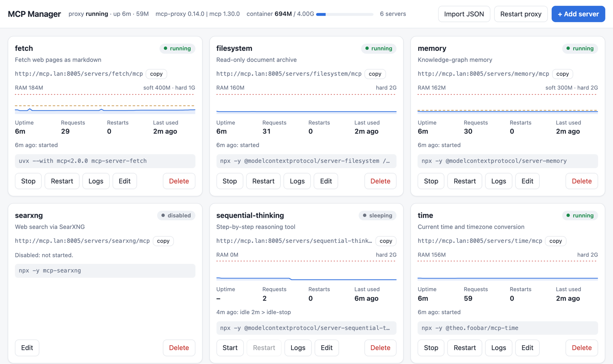
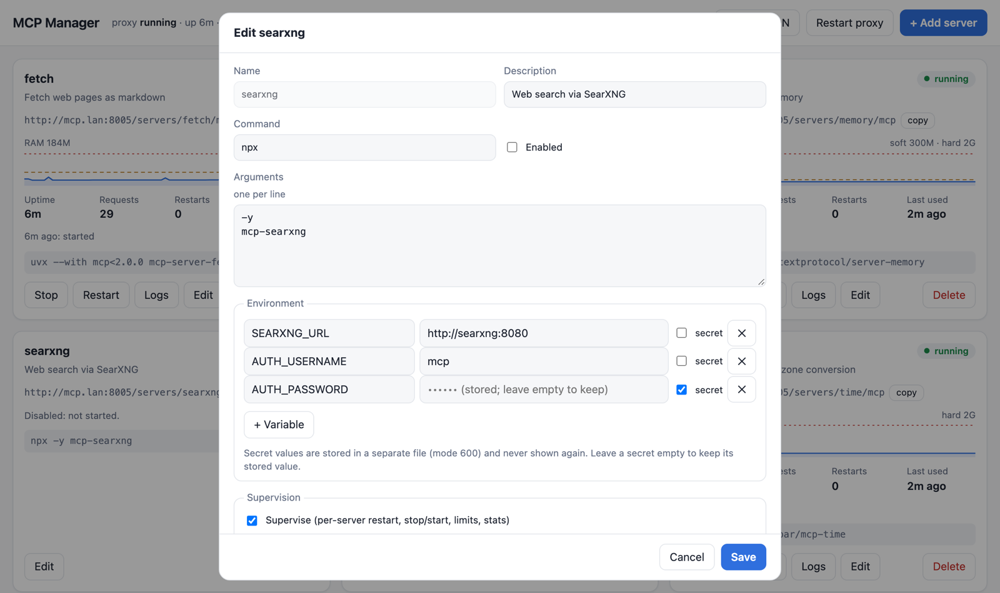
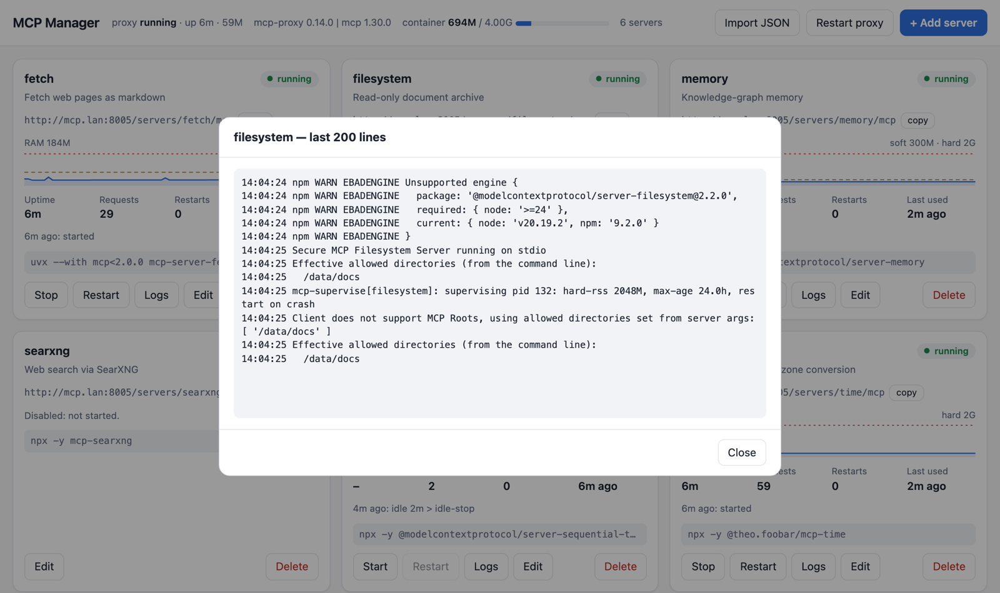
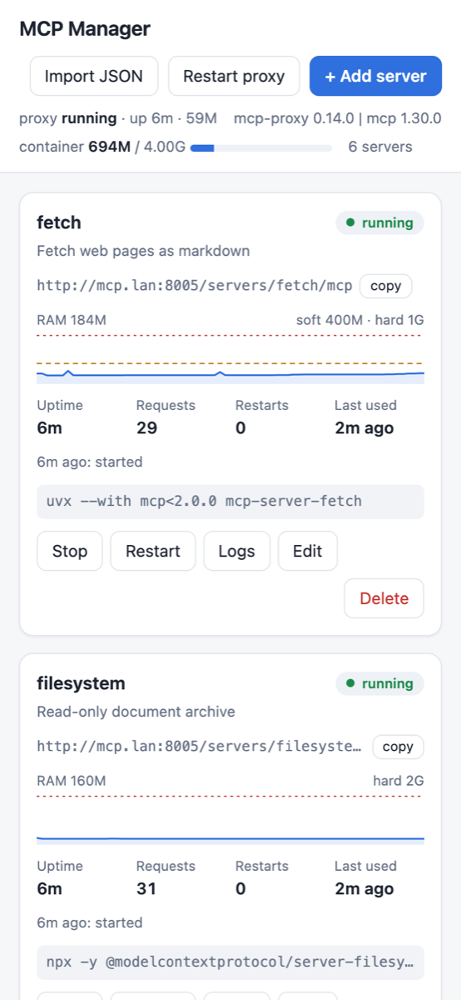

# mcp-manager

[](https://github.com/shuricksumy/mcp-manager/actions/workflows/release.yml)
[](https://github.com/shuricksumy/mcp-manager/actions/workflows/ci.yml)
[](https://github.com/shuricksumy/mcp-manager/pkgs/container/mcp-manager)

Run your stdio MCP servers (`uvx …`, `npx …`) in one Docker container and expose each one over HTTP at `http://<host>:8005/servers/<name>/mcp`. Add, configure, monitor and control them from a web page.

It's built on [`mcp-proxy`](https://github.com/sparfenyuk/mcp-proxy), which does the stdio ⇄ HTTP bridging. On top of that, this project adds an admin page, per-server supervision, and images that are pinned, tested and updated automatically.

<picture>
  <source media="(prefers-color-scheme: dark)" srcset="docs/overview-dark.png">
  
</picture>

## Features

- **Admin page:** add, edit, import, enable/disable and delete servers. Each server is stored in **its own file**, and secret values are kept in a separate file that is never sent to the browser.
- **Monitoring per server:** state, RAM with a 1-hour graph against its limits, uptime, requests and errors, restarts and crashes, the last event, and live logs. The page also shows the container's memory.
- **Control per server:** Start / Stop / Restart, without dropping the sessions of clients using other servers, or even that one.
- **Memory control:**
  - `maxRss`: restart when idle and above the limit.
  - `hardRss`: restart immediately.
  - `maxAge`: restart after running this long, to clear slow leaks.
  - `idleStop`: stop an unused server and start it again on its next request.
- **Failure isolation:** a server that crashes, or fails or hangs at startup, never takes the others down. It's marked **failed** and retried with backoff. Plain mcp-proxy stops *all* servers when one exits, and waits forever for one that hangs at startup.
- **Two images:** a pinned **stable** one, and a weekly **`next`** one that tracks the newest mcp-proxy and is ready for the mcp 2 SDK.
- **Maintained automatically:** Renovate keeps everything pinned and up to date. Updates merge themselves only after the full end-to-end test suite passes.

## Quick start

```yaml
# compose.yml
services:
  mcp-manager:
    image: ghcr.io/shuricksumy/mcp-manager:latest
    container_name: mcp-manager
    restart: unless-stopped
    ports:
      - "8005:8000"     # MCP endpoints: http://<host>:8005/servers/<name>/mcp
      - "8015:8001"     # admin page:    http://<host>:8015  (user: admin)
    environment:
      MCP_MANAGER: "true"
      MCP_MANAGER_PASSWORD: ${MCP_MANAGER_PASSWORD:?set it in .env}
      MCP_PROXY_PUBLISHED_PORT: "8005"                      # used for the endpoint links on the page
      MCP_PROXY_ALLOWED_HOSTS: "192.168.1.10:*,mcp-manager:*"   # every host name clients use (see 421 below)
      MCP_SUPERVISE_HARD_RSS: "2G"                          # default emergency limit per server
    volumes:
      - ./data/mcp:/mcp                    # servers.d/ (one file per server), manager.password
      - ./cache/uv:/root/.cache/uv         # optional: faster uvx starts
      - ./cache/npm:/root/.npm             # optional: faster npx starts
      # - ./documents:/data/documents      # whatever your servers need to read
    mem_limit: 4g                          # backstop for all servers together
    healthcheck:
      test: ["CMD", "curl", "-fsS", "-o", "/dev/null", "http://127.0.0.1:8001/healthz"]
      interval: 30s
      timeout: 5s
      start_period: 60s
```

```sh
echo 'MCP_MANAGER_PASSWORD=<choose-a-strong-password>' > .env
docker compose up -d
```

Open `http://<host>:8015`, log in as `admin`, and add servers with **+ Add server**, or paste an `mcpServers` block with **Import JSON**. If `./data/mcp/servers.json` already exists, it is imported automatically on first start.

From a clone of this repo you can use [compose.yml](compose.yml) and [.env.example](.env.example) instead: `cp .env.example .env && docker compose up -d`.

## Connecting clients

Each server has its own endpoint, and the **copy** button on its card gives you the URL:

| Transport | URL |
|---|---|
| Streamable HTTP | `http://<host>:8005/servers/<name>/mcp` |
| SSE (older clients) | `http://<host>:8005/servers/<name>/sse` |

For a client that takes an `mcpServers` config with URLs:

```json
{
  "mcpServers": {
    "fetch": { "type": "streamable-http", "url": "http://192.168.1.10:8005/servers/fetch/mcp" },
    "time":  { "type": "streamable-http", "url": "http://192.168.1.10:8005/servers/time/mcp" }
  }
}
```

The field names vary between clients, for example `"type": "http"` or `"transport"`. Clients that only speak stdio can connect through a bridge such as `npx mcp-remote <url>`.

## Admin page

| Edit a server | Live logs |
|---|---|
|  |  |



- **Add / edit:**
  - name, description, command, arguments (one per line), environment variables, and limits;
  - **secret** variables are write-only: they're stored, never shown again, and an empty field keeps the stored value;
  - **Enabled** off stops the server and keeps its definition.
- **Import JSON:** paste an `mcpServers` block, for example from a server's README. Variables whose names look like `TOKEN`, `SECRET`, `PASSWORD`, `API_KEY`, `*_KEY` and similar become secrets.
- **Start / Stop / Restart** act on that server only:
  - a stopped server answers requests with an error;
  - a **sleeping** server (idle-stopped) starts again on its next request.
- **Logs** show the last 200 lines from the server and its supervisor, refreshing live.
- **Restart proxy** restarts mcp-proxy with all servers. It's only needed after **adding** a server (see the table below).
- The page works on phones too. The **◐ / ☾ / ☀** button in the header switches the theme between system, dark and light, and the choice is remembered in your browser.

<br clear="right">

### Where servers are stored

One file per server in `./data/mcp/servers.d/`. You can back these files up, edit them by hand, or keep them in git (without the `.secret.json` files):

```
data/mcp/
├── servers.d/
│   ├── fetch.json                     {"description", "enabled", "command", "args", "env", "supervise"}
│   ├── music-assistant.json
│   └── music-assistant.secret.json    {"env": {"MA_TOKEN": "…"}}   mode 600, never sent to the browser
├── manager.password                   generated if MCP_MANAGER_PASSWORD is not set
└── servers.json                       optional: imported once if servers.d/ is empty, then left alone
```

```json
{
  "description": "Fetch web pages as markdown",
  "enabled": true,
  "command": "uvx",
  "args": ["--with", "mcp<2.0.0", "mcp-server-fetch"],
  "env": {},
  "supervise": { "maxRss": "400M", "hardRss": "1G" }
}
```

### How changes apply

| Change | What happens |
|---|---|
| Edit a server (command, args, env, limits) | Only that server restarts. Client sessions keep working |
| Start / Stop / Restart / Disable / Enable / Delete | Immediately, only that server |
| Edit a file in `servers.d/` by hand | Used the next time that server restarts |
| **Add** a server (or turn supervision on/off) | Needs a **proxy restart**, because mcp-proxy reads its server list only at startup. The page shows a banner so you can batch changes. All clients reconnect after a few seconds |

### Login and security

The login is user `admin` with `MCP_MANAGER_PASSWORD`. If that is unset, a password is generated on first start, printed once in `docker logs`, and saved to `data/mcp/manager.password`.

> [!WARNING]
> The admin page can run any command inside the container, so treat it like a root shell. Publish port 8015 only on your LAN or VPN (or don't publish it at all and use an SSH tunnel), and use a strong password. The API rejects requests without credentials (`401`), and rejects writes without its `X-MCP-Manager` header (`403`), which blocks cross-site requests.

**Showing the page in an iframe** (a Home Assistant *iframe panel*, a dashboard such as Homepage or Heimdall):
- **Allow the embedding site:** set `MCP_MANAGER_FRAME_ANCESTORS` to the address of the page that embeds it, exactly as your browser shows it, e.g. `http://192.168.1.10:8123`. By default no site may embed it, because a page with Stop/Delete buttons in someone else's frame invites clickjacking, so only list sites you trust. `*` allows any site.
- **HTTPS:** if the embedding site uses `https://`, the admin page must be served over `https://` too, behind a reverse proxy. Browsers block `http://` frames inside `https://` pages.

The MCP endpoints themselves (port 8005) have **no authentication**. That's how mcp-proxy works in server mode. Keep them on a trusted network, or put an authenticating reverse proxy in front.

## Memory and supervision

mcp-proxy starts each stdio server **once** and shares it between all clients, so a memory leak keeps growing for as long as the container runs. And if **one** server exits, mcp-proxy shuts down and takes **all** of them with it.

[`mcp-supervise`](mcp-supervise.py) sits between mcp-proxy and each server (`mcp-proxy ⇄ mcp-supervise ⇄ uvx/npx …`). It restarts or stops that one server **without mcp-proxy noticing**. After each start it replays the original MCP `initialize` handshake, so mcp-proxy and every client session behind it keep working.

| Limit (page field / `"supervise"` key) | Default for all servers | What happens |
|---|---|---|
| Max RSS / `maxRss`, e.g. `800M` | `MCP_SUPERVISE_MAX_RSS` | RAM of the server's whole process tree above this → restart once no request is in flight |
| Hard RSS / `hardRss`, e.g. `2G` | `MCP_SUPERVISE_HARD_RSS` | Above this → restart immediately. Requests in flight get an error instead of hanging |
| Max age / `maxAge`, e.g. `24h` | `MCP_SUPERVISE_MAX_AGE` | Running longer than this → restart once idle (clears slow leaks) |
| Idle stop / `idleStop`, e.g. `2h` | `MCP_SUPERVISE_IDLE_STOP` | Unused for this long → stop (frees all its RAM). The next request starts it again; only that first call is slower |
| `logInterval`, e.g. `15m` | `MCP_SUPERVISE_LOG_INTERVAL` | Writes its RAM use to the log this often (default `1h`) |
| `startTimeout`, e.g. `300s` | `MCP_SUPERVISE_START_TIMEOUT` | First start: no answer within this (default `120s`) → **failed**, retried with backoff |
| *(always on)* | | Crash → restart only that server, with backoff. A server that fails at startup, or crashes more than 5 times in 10 min, is marked **failed**: its requests get an error pointing to its log, and it's retried every 2 s → 5 min until it comes up. mcp-proxy and the other servers keep running |

**Choosing limits:** let it run for a day without limits and watch the RAM graphs. Set **Max RSS** to about 2–3× a server's normal value. Use **Hard RSS** as an emergency limit and `mem_limit` as a backstop for the whole container. For servers you rarely use, **Idle stop** saves the most RAM.

**What a restart loses:** state kept inside the server, such as resource subscriptions. That's fine for the usual stateless tool servers. Requests that aren't in flight are never affected.

## Images

Built by CI for `linux/amd64` and `linux/arm64` and published to GHCR:

| Tag | What it is |
|---|---|
| `ghcr.io/shuricksumy/mcp-manager:latest` | **Stable.** mcp-proxy, the `mcp` SDK, uv and Python are all pinned ([Dockerfile](Dockerfile)). Updates arrive through tested Renovate PRs |
| `ghcr.io/shuricksumy/mcp-manager:<version>` (e.g. `0.14.0`) | Stable, per mcp-proxy version, for pinning or rollback |
| `ghcr.io/shuricksumy/mcp-manager:next` | **Newest.** The latest mcp-proxy, uv and `python:3.12-slim`, rebuilt every week ([Dockerfile.next](Dockerfile.next)). Run it next to stable with [compose.next.yml](compose.next.yml) (ports 8006/8016, its own `data/mcp-next`) |

Both images fail their build if mcp-proxy can't be imported, so a broken combination never gets published.

**mcp 2.x:** mcp-proxy (0.14.0, and 0.15.0 on its `main` branch) still requires `mcp<2`, because mcp 2.0 removed `request_ctx`, which mcp-proxy uses. Every week the [mcp2-probe](.github/workflows/mcp2-probe.yml) workflow builds `:next` with `MCP_SPEC=mcp>=2`, and opens an issue the first time that works. Your servers are independent of this: each `uvx` server runs in its own environment, which is why the examples pin `--with mcp<2.0.0` per server.

## Without the admin page

With `MCP_MANAGER=false` (the default in compose), the container runs plain mcp-proxy with a hand-written `./data/mcp/servers.json`. See [data/mcp/servers.json.example](data/mcp/servers.json.example).

- **Format:** each server has `command`, `args`, optional `env` and `enabled`. Any other keys, such as `timeout` or `type`, are ignored.
- **Supervision** is optional: set `MCP_SUPERVISE=true`, or add a `"supervise"` object per server.
- **Env values** are literal; `${VAR}` is not expanded. To keep secrets out of the file, use `MCP_PROXY_PASS_ENV=true` and pass them as container env vars.

## Configuration reference

| Variable | Default | Effect |
|---|---|---|
| **Admin page** | | |
| `MCP_MANAGER` | `false` | `true` → admin page, servers stored in `servers.d/`, every server supervised |
| `MCP_MANAGER_PASSWORD` | *(generated)* | Admin password (user `admin`) |
| `MCP_MANAGER_PORT` | `8001` | Admin page port inside the container |
| `MCP_MANAGER_PUBLISHED_PORT` | `8015` | Host port for the admin page (compose only) |
| `MCP_MANAGER_FRAME_ANCESTORS` | *(nobody)* | Sites allowed to show the admin page in an **iframe**, space-separated, e.g. `http://192.168.1.10:8123 https://ha.example.com` (see below) |
| **Supervision defaults** | | |
| `MCP_SUPERVISE` | `false` | Supervise every server (always on with `MCP_MANAGER=true`) |
| `MCP_SUPERVISE_MAX_RSS` / `_HARD_RSS` / `_MAX_AGE` / `_IDLE_STOP` / `_LOG_INTERVAL` | *(none)* | Defaults for the limits above |
| **mcp-proxy** | | |
| `MCP_PROXY_PUBLISHED_PORT` | `8005` | Host port for the MCP endpoints, also used for the links on the page |
| `MCP_PROXY_ALLOWED_HOSTS` | *(empty)* | Comma list → repeated `--allowed-host`, e.g. `192.168.1.10:*,mcp-manager:*` |
| `MCP_PROXY_ALLOW_ORIGINS` | `*` | Comma list → repeated `--allow-origin`. Empty turns CORS off |
| `MCP_PROXY_PASS_ENV` | `false` | `true` → `--pass-environment`: servers inherit the container environment |
| `MCP_PROXY_LOG_LEVEL` / `MCP_PROXY_DEBUG` | | `--log-level` / `--debug` |
| `MCP_PROXY_EXTRA_ARGS` | *(empty)* | Raw extra flags, split on whitespace |
| `MCP_PROXY_HOST` / `MCP_PROXY_PORT` / `MCP_PROXY_TRANSPORT` / `MCP_PROXY_CONFIG` | `0.0.0.0` / `8000` / `streamablehttp` / `/mcp/servers.json` | Rarely changed |
| `MCP_PROXY_CONTAINER_NAME`, `MCP_CONFIG_DIR`, `MCP_PROXY_IMAGE_TAG` | | Compose only: container name, host config dir, image tag |

The full mcp-proxy command line is printed at startup (only flags, never env values).

## Troubleshooting

- **HTTP 421 "Invalid Host header":** since 0.13.3, mcp-proxy only accepts loopback `Host` headers. Add every name clients use (LAN IP, DNS name, container name) to `MCP_PROXY_ALLOWED_HOSTS`; a wildcard port (`host:*`) is supported. `MCP_PROXY_ALLOW_ORIGINS` only covers the `Origin` header and doesn't fix this.
- **A new server shows "not loaded":** it's saved but mcp-proxy hasn't loaded it yet. Click **Restart proxy** in the banner.
- **A server shows "failed":** open its **Logs** to see why (missing package, wrong arguments, bad env). It's retried automatically, and **Restart** retries it now. The other servers are unaffected. A first `uvx` start that downloads a lot (e.g. `mcp-server-qdrant` with its embedding model) can exceed the 120 s start timeout; it then recovers on a retry, or you can raise `startTimeout` for that server.
- **`npm WARN EBADENGINE … required: { node: '>=24' }`** in a server's log: the image currently ships Debian's Node.js 20. Most servers still work. A server that really needs a newer Node won't start.
- **First start is slow:** `uvx`/`npx` download each server on its first run. Mounting the uv and npm caches (see Quick start) makes later starts fast.
- **docker.sock:** if a server needs `/var/run/docker.sock`, mounting it `:ro` **still effectively gives root on the host**, because read-only applies to the socket file, not to the Docker API. Mount it only for servers you trust.

## Development

- **Tests**, run in CI on both images:
  - [scripts/smoke-test.sh](scripts/smoke-test.sh): MCP `initialize` with an allowed Host, and 421 for an unknown one.
  - [tests/supervise-test.py](tests/supervise-test.py): 25 checks covering limits, crash, in-flight protection, control socket, idle-stop, and servers that crash, hang or flake at startup.
  - [tests/manager-test.py](tests/manager-test.py): 25 checks covering auth, import and secrets, a live edit keeping the client session, stop/start, add + proxy restart, validation and persistence.
- **Run locally:** `docker build -t mcp-manager:dev . && python3 tests/manager-test.py mcp-manager:dev`.
- **Workflows:**
  - **ci** on every PR;
  - **release** on push to `main`, weekly and on demand: runs CI, then publishes `:latest`, `:<version>` and `:next`;
  - **mcp2-probe** weekly;
  - also CodeQL, zizmor, dependency-review, Renovate config validation and a monthly GHCR cleanup.
- **`main` is protected:** changes go through PRs, and the required checks are both image builds (with all tests), shellcheck, CodeQL and dependency-review.
- **Renovate** ([renovate.json](renovate.json), shared preset `shuricksumy/renovate-config`) owns version updates. **Patch and minor updates merge themselves once the required checks pass.** The exceptions:
  - **Majors** wait for a review.
  - **Python is locked to 3.12:** minor and major Python upgrades are never proposed, because `uvx` servers run on the image's Python and a new minor can break them (3.15 broke `mcp-server-qdrant`). 3.12 patch and security refreshes still merge themselves.
  - **mcp-proxy and `mcp`** are bumped together, after a 3-day settling period.
  - **`mcp` 2.x** is skipped for the stable image.
- **Dependabot** only opens security updates. Patch and minor security fixes merge themselves.
