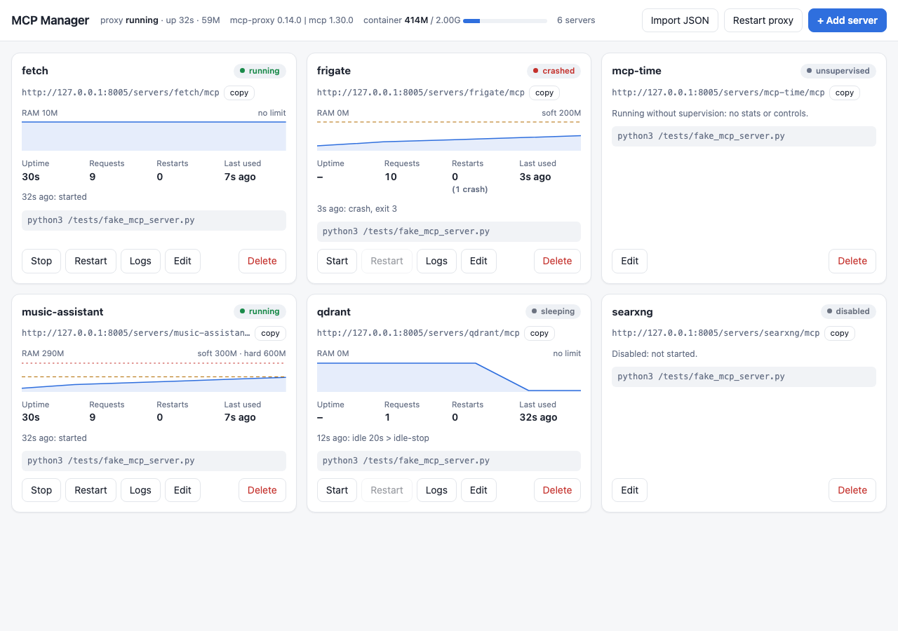

# mcp-manager

Run your stdio MCP servers in one Docker container and expose each one over HTTP (streamable HTTP and SSE) at `/servers/<name>/mcp`, using [`mcp-proxy`](https://pypi.org/project/mcp-proxy/) (sparfenyuk).

- **Admin page:** add, edit, monitor and control each server. Definitions are stored one file per server, with secrets kept separate.
- **Per-server supervision:** memory and age limits, crash restarts, stop/start and idle-stop, without dropping client sessions.
- **Two images:** a pinned stable one and a `next` one that tracks the newest mcp-proxy (and is ready for mcp 2).
- **Configuration through environment variables:** mcp-proxy itself doesn't read its options from the environment, so an entrypoint script turns them into command-line flags.

## Images

Both are built by CI and published to GHCR for `linux/amd64` and `linux/arm64`:

| Tag | Dockerfile | What it is |
|---|---|---|
| `ghcr.io/shuricksumy/mcp-manager:latest` | [Dockerfile](Dockerfile) | **Stable.** mcp-proxy, `mcp`, uv and Python all pinned. Renovate bumps them through PRs that only merge when CI passes. |
| `ghcr.io/shuricksumy/mcp-manager:<version>` (e.g. `0.14.0`) | [Dockerfile](Dockerfile) | Stable, kept per mcp-proxy version for pinning or rollback. |
| `ghcr.io/shuricksumy/mcp-manager:next` | [Dockerfile.next](Dockerfile.next) | **Newest.** Latest mcp-proxy, uv and `python:3.12-slim`, rebuilt every week. Can force a newer `mcp` SDK (`MCP_SPEC`). Has its own compose file, `.env` and `servers.json`. |

Both images run a smoke test while building: the build fails if mcp-proxy cannot import. A broken combination, such as forcing `mcp>=2` today, therefore never produces an image.

**mcp 2.x:** mcp-proxy (0.14.0 on PyPI, and 0.15.0 on `main`) still requires `mcp<2`, because mcp 2.0 removed `request_ctx`, which mcp-proxy imports. The weekly [mcp2-probe](.github/workflows/mcp2-probe.yml) workflow builds `:next` with `MCP_SPEC=mcp>=2`. It opens an issue the first time that works.

## Quick start

```sh
cp .env.example .env
cp data/mcp/servers.json.example data/mcp/servers.json   # then edit
docker compose pull && docker compose up -d     # or: docker compose up -d --build
docker logs -f mcp-proxy
```

The `next` image runs side by side on port 8006, with its own config:

```sh
cp .env.next.example .env.next
cp data/mcp-next/servers.json.example data/mcp-next/servers.json   # then edit
docker compose -f compose.next.yml --env-file .env.next pull
docker compose -f compose.next.yml --env-file .env.next up -d
```

To test a local image: `scripts/smoke-test.sh <image>`. It starts the image with one stdio server and expects a successful MCP `initialize` for an allowed Host, and HTTP 421 for an unknown one.

Endpoints: `http://<host>:8005/servers/<name>/mcp` (streamable HTTP) and `.../servers/<name>/sse`.

`servers.json` uses the `mcpServers` format: each entry has `command`, `args` (a list), an optional `env` (object) and an optional `enabled` (default `true`). mcp-proxy ignores any other keys, such as `timeout`, `type` or `transportType`. `env` values are literal. `${VAR}` is **not** expanded, so to keep secrets out of the file, set `MCP_PROXY_PASS_ENV=true` and pass them as container env vars.

## Admin page (mcp-manager)



With `MCP_MANAGER=true`, servers are managed from a web page instead of a hand-edited `servers.json`:

- **Add, edit, delete** servers: command, arguments, environment (with **secret** values) and limits. You can also **import** an `mcpServers` JSON block, e.g. from a server's README.
- **Monitor** each server: state, RAM with a 1-hour graph against its limits, uptime, requests and errors, restarts and crashes, last event, and live **logs**.
- **Control** each server: **Start / Stop / Restart**. A stopped server answers requests with an error, and an idle-stopped one ("sleeping") wakes on the next request.
- The page also shows mcp-proxy's state and version and the container's memory use, and has a **Restart proxy** button.

**Storage:** one file per server in `<MCP_CONFIG_DIR>/servers.d/` (on the host: `./data/mcp/servers.d/`):

```
servers.d/frigate.json               {"description", "enabled", "command", "args", "env", "supervise"}
servers.d/music-assistant.json
servers.d/music-assistant.secret.json   {"env": {"MA_TOKEN": "..."}}  mode 600, never sent to the browser
```

On first start, an existing `servers.json` is imported. Variables whose names look like `TOKEN`, `KEY`, `SECRET` or `PASSWORD` go to the `.secret.json` files, and `servers.json` itself is left untouched. You can also edit or back up the files by hand. Changes are picked up on the next restart of that server.

**How changes apply:**

| Change | Effect |
|---|---|
| Edit a server (command, args, env, limits) | Only that server restarts. Client sessions keep working |
| Stop / Start / Restart / Disable / Enable / Delete | Immediate, only that server |
| **Add** a new server | Needs a **proxy restart**: mcp-proxy reads its server list only at startup. The page shows a banner, so you can batch changes. All clients reconnect after a few seconds |

**Login:** user `admin`, password from `MCP_MANAGER_PASSWORD`. If that is unset, a password is generated on first start, printed once in `docker logs`, and stored in `<MCP_CONFIG_DIR>/manager.password`.

> **Security:** the admin page can run any command inside the container, so treat it like a root shell. Publish its port only on your LAN or VPN (or keep it unpublished and use an SSH tunnel), and set a strong password. The API rejects requests without credentials (`401`), and rejects writes without its `X-MCP-Manager` header (`403`), which blocks cross-site requests.

## Per-server supervision (memory, age, crashes, idle stop)

mcp-proxy starts each stdio server **once** and shares it between all clients, so a leak keeps growing for as long as the container runs. If **one** server exits, mcp-proxy shuts down and takes **all** of them with it.

[`mcp-supervise`](mcp-supervise.py) sits between mcp-proxy and each server (`mcp-proxy ⇄ mcp-supervise ⇄ uvx/npx …`). It restarts or stops that one server **without mcp-proxy noticing**. After each start it replays the original MCP `initialize` handshake, so mcp-proxy and every client session behind it keep working.

| Option (`servers.json` → `"supervise"`) | Env default | What happens |
|---|---|---|
| `maxRss` e.g. `800M` | `MCP_SUPERVISE_MAX_RSS` | RSS of the server's whole process tree above this → restart once no request is in flight |
| `hardRss` e.g. `2G` | `MCP_SUPERVISE_HARD_RSS` | Above this → restart immediately. Requests in flight get a JSON-RPC error instead of hanging |
| `maxAge` e.g. `24h` | `MCP_SUPERVISE_MAX_AGE` | Running longer than this → restart once idle (clears slow leaks) |
| `idleStop` e.g. `2h` | `MCP_SUPERVISE_IDLE_STOP` | Unused for this long → stop (frees all its RAM). The next request starts it again (only that first call is slower) |
| `logInterval` e.g. `15m` | `MCP_SUPERVISE_LOG_INTERVAL` | Logs its RSS this often (default `1h`). Useful for choosing limits |
| *(always)* | | Crash → restart only that server, with backoff. More than 5 crashes in 10 min → give up, as before (mcp-proxy exits and Docker restarts the container) |

`MCP_SUPERVISE=true` wraps every server, using the env defaults. Per server, `"supervise": {…}` overrides them, and `"supervise": false` opts that server out. mcp-proxy itself ignores the key. See [data/mcp/servers.json.example](data/mcp/servers.json.example). The entrypoint writes a wrapped copy of the config to `/tmp`. Your file is never modified.

**Choosing limits:** run for a day with `MCP_SUPERVISE=true` and no limits. Look at the hourly `rss` lines (`docker logs proxy-mcp | grep rss`) and set `maxRss` to about 2–3× the normal value. Then add `hardRss` as an emergency limit, plus `mem_limit` in compose as a final backstop for the whole container.

**Control socket:** each supervised server listens on `/run/mcp-supervise/<name>.sock` (one JSON line per command: `status`, `log`, `restart`, `stop`, `start`). For example:

```sh
docker exec proxy-mcp python3 -c "import socket,sys;s=socket.socket(socket.AF_UNIX);s.connect('/run/mcp-supervise/fetch.sock');s.sendall(b'{\"cmd\":\"status\"}\n');print(s.makefile().readline())"
```

**What is lost on a restart:** state kept inside the server, such as resource subscriptions. That's fine for the usual stateless tool servers. Requests that are not in flight are never affected.

## Environment variables

| Variable | Default | Effect |
|---|---|---|
| `MCP_PROXY_PUBLISHED_PORT` | `8005` | Host port (compose only) |
| `MCP_PROXY_CONTAINER_NAME` | `mcp-proxy` | Container name (compose only) |
| `MCP_CONFIG_DIR` | `./data/mcp` | Host dir mounted at `/mcp` (compose only) |
| `MCP_PROXY_HOST` | `0.0.0.0` | `--host` |
| `MCP_PROXY_PORT` | `8000` | `--port` (container side) |
| `MCP_PROXY_TRANSPORT` | `streamablehttp` | `--transport` (mcp-proxy treats it as a client-mode option; server mode serves both `/mcp` and `/sse`) |
| `MCP_PROXY_CONFIG` | `/mcp/servers.json` | `--named-server-config` |
| `MCP_PROXY_ALLOWED_HOSTS` | *(empty)* | Comma list → repeated `--allowed-host`, e.g. `192.168.111.111:*,proxy-mcp:*` |
| `MCP_PROXY_ALLOW_ORIGINS` | `*` | Comma list → repeated `--allow-origin`. Set it to empty to turn CORS off |
| `MCP_PROXY_PASS_ENV` | `false` | `true` → `--pass-environment` |
| `MCP_PROXY_LOG_LEVEL` | *(empty)* | `--log-level` |
| `MCP_PROXY_DEBUG` | `false` | `true` → `--debug` |
| `MCP_PROXY_EXTRA_ARGS` | *(empty)* | Raw extra flags, split on whitespace |

List items are trimmed and empty items are skipped. Arguments given in compose `command:` are added at the end. The full command is printed at startup. Only flags are printed, never environment values.

## Troubleshooting: HTTP 421 "Invalid Host header"

From 0.13.3 on, mcp-proxy has DNS-rebinding protection. It accepts only loopback `Host` headers and the bind host. Requests from LAN clients (`Host: 192.168.111.111:8005`) or from other containers (`Host: proxy-mcp:8000`) fail with **421**, and the log shows `Invalid Host header: ...`. To fix it, list every hostname clients use in `MCP_PROXY_ALLOWED_HOSTS`. A wildcard port (`host:*`) is supported. `--allow-origin` only covers the `Origin` header. It does not help with this error.

## Security

- **There is no authentication.** In server mode, mcp-proxy does not check incoming credentials. `API_ACCESS_TOKEN` only applies in client mode, so setting it does **not** protect this endpoint. Limit who can reach the port (firewall, an internal Docker network, a VPN), or put an authenticating reverse proxy in front.
- If a stdio server needs `/var/run/docker.sock`, mounting it `:ro` **still effectively gives root on the host**. Read-only applies to the socket file, not to the Docker API, which can still start privileged containers. Mount it only for servers you trust.
- `MCP_PROXY_PASS_ENV=true` passes the whole container environment to every stdio server.

## Automation

- **ci** (PRs, and before every publish): builds both images and runs the smoke test plus the end-to-end tests for mcp-supervise ([tests/supervise-test.py](tests/supervise-test.py)) and mcp-manager ([tests/manager-test.py](tests/manager-test.py)) on each, plus shellcheck.
- **release** (push to `main`, weekly, manual): runs CI, then publishes `:latest`, `:<version>` and `:next`.
- **Renovate** ([renovate.json](renovate.json), shared preset `shuricksumy/renovate-config`) owns version updates.
  - mcp-proxy and `mcp` are updated together in one PR. Patch and minor updates merge automatically once CI passes.
  - `mcp` 2.x is skipped for the stable image (see mcp2-probe above).
  - Action and image digest pins, and uv patch/minor updates, also merge automatically.
- **Dependabot** handles security updates only. Security patch PRs merge automatically.
- Also: CodeQL (scans the workflows), zizmor, dependency-review, Renovate config validation, and a monthly GHCR cleanup of untagged images.
